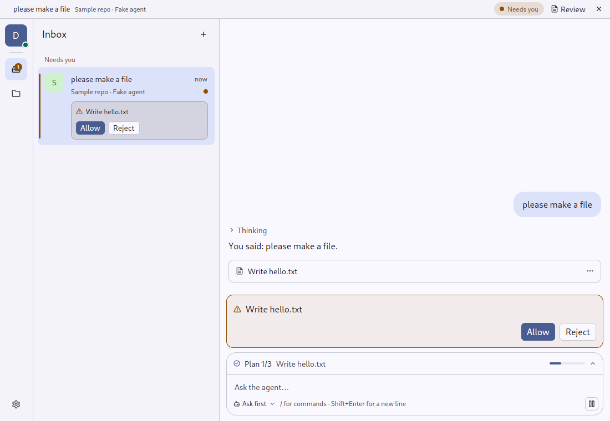
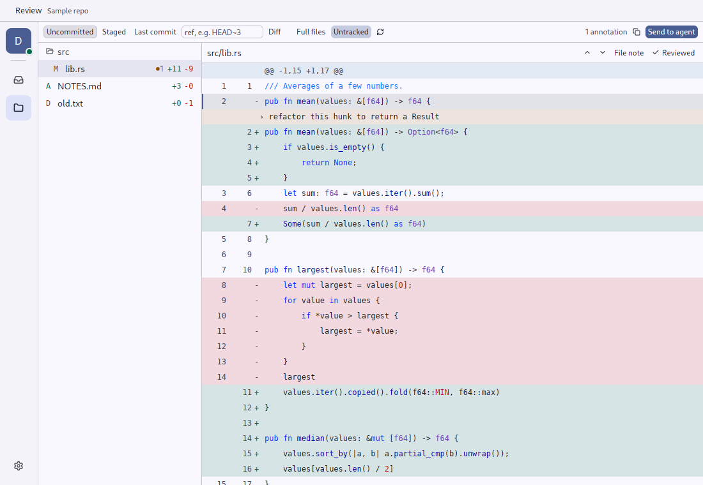
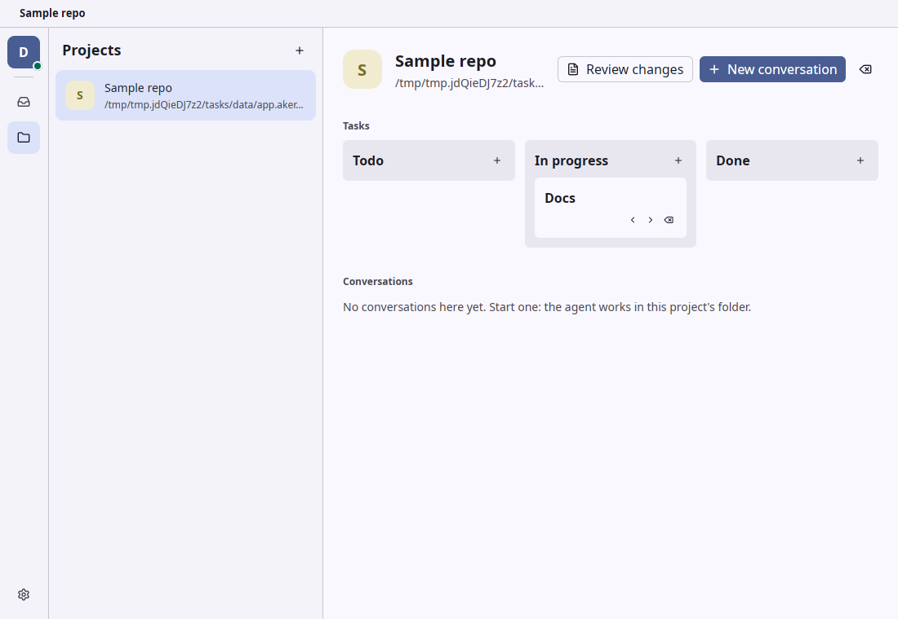
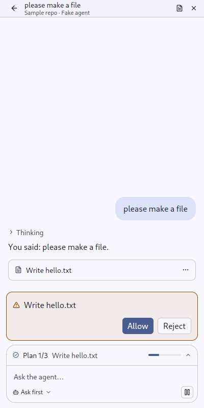
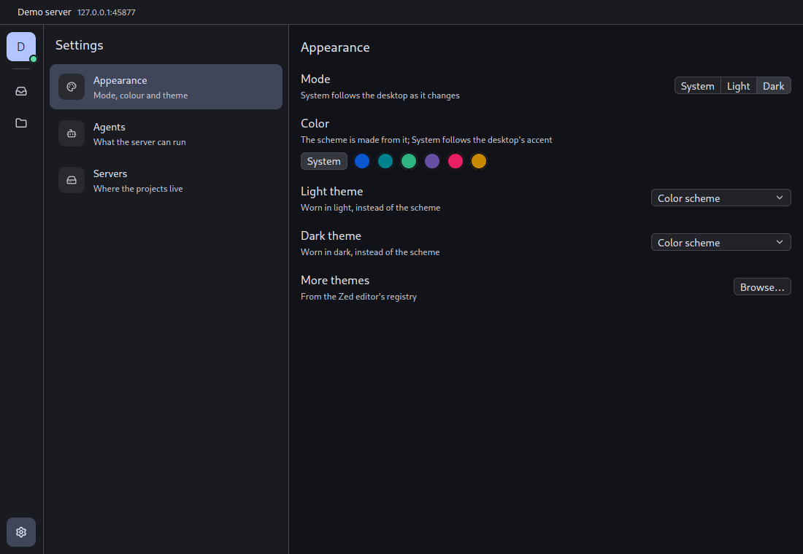

# Aiddiction

Your coding agents on your own servers, from the desktop or a phone.

Aiddiction runs [ACP](https://agentclientprotocol.com) agents — Claude Code,
Codex, or anything else that speaks ACP — in projects on a machine you own,
and keeps every conversation one click away: one inbox across all your
servers, the agent's questions answered right in the list, its changes
reviewed line by line and sent back to it.



- **One inbox** for every conversation on every server: what needs you, what
  is working, what is done.
- **Projects** are folders on the server — empty, `git clone`d, or already
  there — with a task board each.
- **Review** the diff the way [revdiff](https://github.com/umputun/revdiff)
  does: annotate lines, send the notes to the agent, repeat.
- **Anywhere**: Linux, macOS, Windows and Android clients; light, dark,
  Material You colours or any Zed theme.



<table>
  <tr>
    <td></td>
    <td rowspan="2"></td>
  </tr>
  <tr>
    <td></td>
  </tr>
</table>

## Server

On Linux, as a systemd user service (run again to update):

```sh
curl -fsSL https://github.com/Akergez/aiddiction/releases/latest/download/install-server.sh | sh
# reachable from a phone, and running after you log out:
curl -fsSL https://github.com/Akergez/aiddiction/releases/latest/download/install-server.sh | sh -s -- --listen 0.0.0.0:7878 --linger
```

It prints the address and the access token (again with
`aiddiction-server token`) and keeps projects in `~/aiddiction-projects`.
From a checkout: `cargo run --release -p aiddiction-server -- install`.
`aiddiction-server uninstall` removes the service and keeps the data.

The agents run through their ACP adapters with `npx`, so the server needs
Node, and each agent must be signed in there (`claude`, `codex login`) — or
sign in from the client. To reach the server from a phone, put it on an
address the phone can reach (Tailscale is the easy way) with TLS in front.
Configuration lives in `~/.config/aiddiction-server/config.toml`; more agents
go there or are added from a project's page:

```toml
[[agents]]
id = "gemini"
name = "Gemini CLI"
command = "gemini"
args = ["--experimental-acp"]
```

## Client

Download a package from the
[latest release](https://github.com/Akergez/aiddiction/releases/latest), or:

```sh
flatpak install https://akergez.github.io/aiddiction/app.akergez.Aiddiction.flatpakref
cargo run --release -p aiddiction        # from a checkout
```

Add a server by its address and token. To look around without one,
`AIDDICTION_DEMO=1 cargo run -p aiddiction` starts a local server with a fake
agent (see [`CLAUDE.md`](CLAUDE.md)).

## Building

Stable Rust (pinned in `rust-toolchain.toml`); the client on Linux also needs
Wayland/X11, Vulkan and font libraries:

```sh
# Debian / Ubuntu
sudo apt install pkg-config libwayland-dev libxkbcommon-dev libxkbcommon-x11-dev \
  libxcb1-dev libvulkan-dev libfontconfig-dev libfreetype-dev
# Fedora
sudo dnf install wayland-devel libxkbcommon-devel libxkbcommon-x11-devel \
  libxcb-devel vulkan-loader-devel fontconfig-devel freetype-devel
```

```sh
cargo build --release -p aiddiction -p aiddiction-server
cargo test --workspace
```

More: [packages and releases](docs/RELEASING.md), [Android](android/README.md),
[the design](docs/PLAN.md) (in Russian).

## License

GPL-3.0, see [LICENSE](LICENSE). Icons: [Lucide](https://lucide.dev), ISC.
